# Evidence: DSO202 Assignment 4, GitOps Delivery of the Task Tracker

| Item | Value |
|---|---|
| Repository | https://github.com/Tshewangdorji7257/dso202-gitops.git |
| Submitted commit (`main`) | `<sha>` (output of `git rev-parse main`) |
| Release tags | `v1.0.0`, `v1.1.0`, `v1.2.0` |
| Cluster | kind `dso202-gitops`: 1 control plane, 2 workers, Kubernetes v1.36.1 |
| Workstation | Windows, PowerShell; Argo CD UI and API on `https://localhost:8443` |

## Contents
1. [Task 1: Tool check, repository and chart](#task-1-tool-check-repository-and-chart)
2. [Task 2: Argo CD installed from bootstrap/argocd](#task-2-argo-cd-installed-from-bootstrapargocd)
3. [Task 3: AppProjects and the root Application](#task-3-appprojects-and-the-root-application)
4. [Task 4: Sealed Secrets and the platform layer](#task-4-sealed-secrets-and-the-platform-layer)
5. [Task 5: Workloads, sync waves and smoke test](#task-5-workloads-sync-waves-and-smoke-test)
6. [Task 6: reviewer account and RBAC](#task-6-reviewer-account-and-rbac)
7. [Task 7: Release, failure and recovery](#task-7-release-failure-and-recovery)
8. [Task 8: Drills](#task-8-drills)
9. [Task 9: Rebuild from the repository and the key](#task-9-rebuild-from-the-repository-and-the-key)
10. [Problems met and how they were solved](#problems-met-and-how-they-were-solved)

---

## Task 1: Tool check, repository and chart

### 1.1 Tool check (all seven tools, pinned versions)

**Figure 1: Tool check: docker, kind, kubectl, helm, git, argocd v3.5.6, kubeseal 0.40.0.** All seven required tools run with the pinned versions: Docker, kind, kubectl, Helm v3.18.6, git, argocd v3.5.6 and kubeseal 0.40.0.

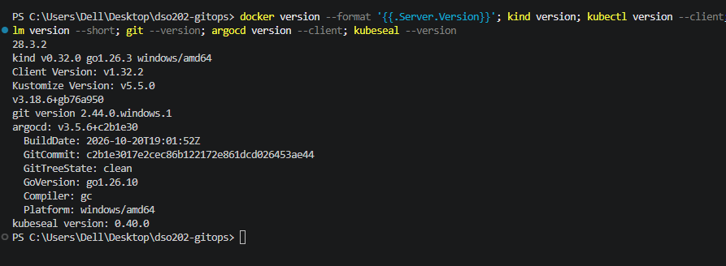

### 1.2 Sealed Secrets chart 2.20.0 is available
`2.20.0 / 0.40.0` is listed. Newer versions also exist but are not used (versions are pinned, section 3.1).

**Figure 2: helm search repo sealed-secrets.** The Bitnami repository lists chart 2.20.0 (controller 0.40.0), the exact version pinned in section 3.1; newer versions are ignored on purpose.

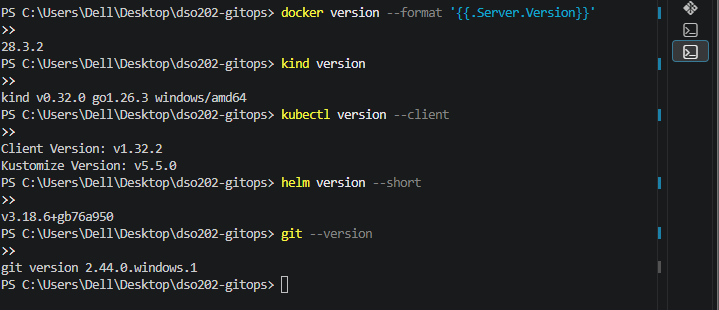

### 1.3 Chart lint, render and history
Both values files lint with `0 chart(s) failed`. The rendered kinds are exactly `ConfigMap, Deployment, Job, Service, StatefulSet`; this list is the dso202 project whitelist in Task 3.

**Figure 3: helm lint, dev values.** helm lint with the dev values passes (0 failed); the icon message is informational only.

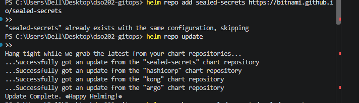

**Figure 4: helm lint, staging values.** helm lint with the staging values also passes, so the same chart is valid for both environments.

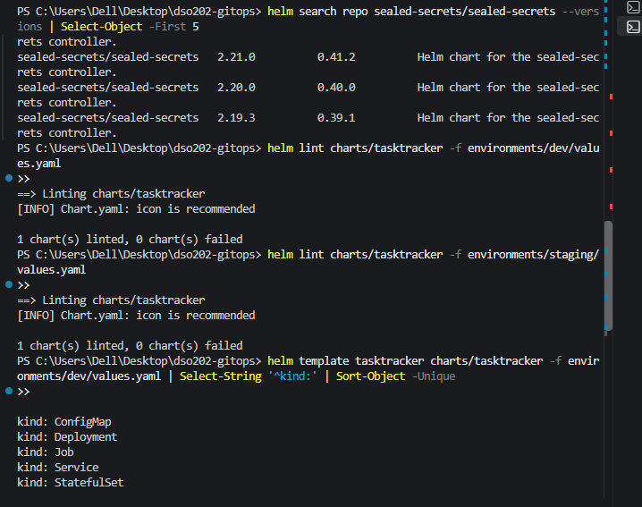

**Figure 5: helm template kinds / git history.** helm template lists only ConfigMap, Deployment, Job, Service and StatefulSet; this exact list becomes the dso202 project whitelist.

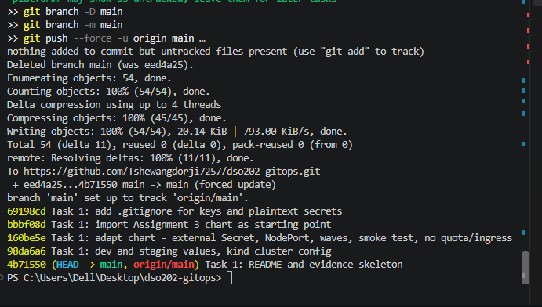

`.gitignore` is the first commit; the Assignment 3 chart is imported unchanged, then adapted in its own commit:

```text
69198cd Task 1: add .gitignore for keys and plaintext secrets
bbbf08d Task 1: import Assignment 3 chart as starting point
160be5e Task 1: adapt chart - external Secret, NodePort, waves, smoke test, no quota/ingress
98da6a6 Task 1: dev and staging values, kind cluster config
4b71550 Task 1: README and evidence skeleton
```

### 1.4 Cluster created from `cluster/kind-cluster.yaml`

**Figure 6: kind create cluster dso202-gitops.** The kind cluster dso202-gitops is created from cluster/kind-cluster.yaml, the Practical 1 configuration under the new name.

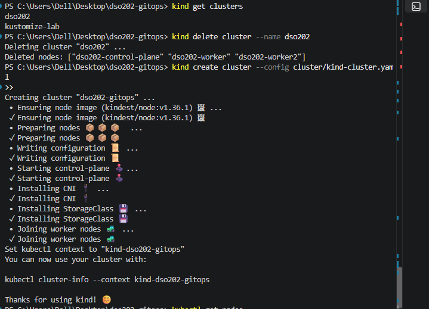

**Figure 7: kubectl get nodes.** All three nodes (control-plane, worker-node-1, worker-node-2) are Ready on Kubernetes v1.36.1.

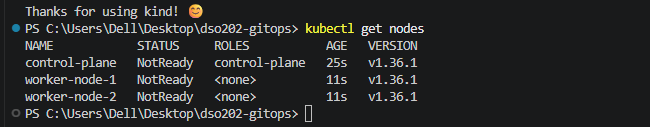

---

## Task 2: Argo CD installed from bootstrap/argocd

### 2.1 Commit and server-side apply
`bootstrap/argocd` was committed on its own, then applied with `--server-side --force-conflicts`. The ApplicationSet CRD is larger than the client-side annotation limit.

**Figure 8: Task 2 commit.** Only bootstrap/argocd is committed in this step, keeping one concern per commit.

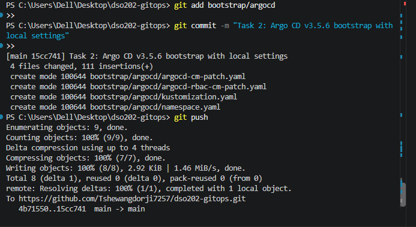

**Figure 9: kubectl apply -k bootstrap/argocd --server-side.** Argo CD v3.5.6 is installed from the pinned upstream manifest plus local patches, using server-side apply.

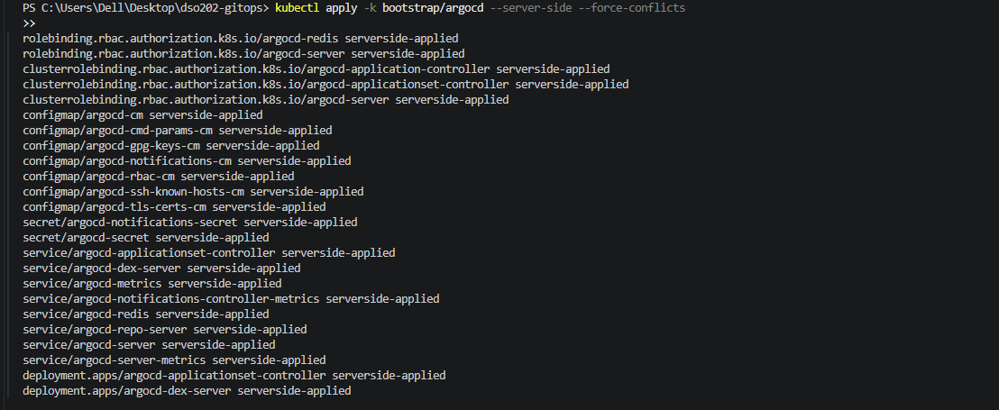

**Figure 10: Waiting for the Argo CD Pods.** The wait shows the Argo CD Pods starting; two images took longer to download on a slow link.

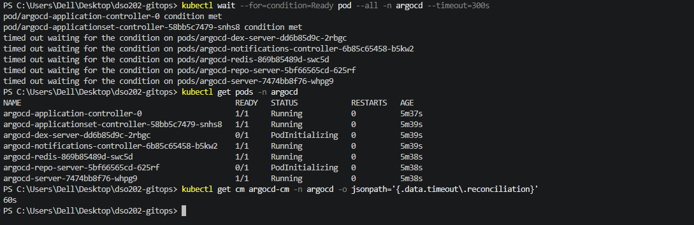

### 2.2 Seven Pods running, nodes Ready, local settings applied
On a slow connection, dex-server and repo-server took longer to download their images; all seven then reached `1/1 Running`. `timeout.reconciliation` is `60s`.

**Figure 11: Seven Argo CD Pods Running.** All seven Argo CD Pods are 1/1 Running: application-controller, applicationset-controller, dex, notifications, redis, repo-server and server.

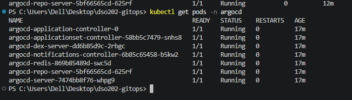

**Figure 12: All three nodes Ready.** The nodes are Ready after kind finished installing the CNI.

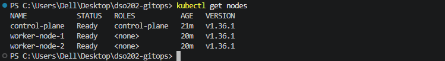

### 2.3 Access to the API server and UI
Port 8080 is reserved by Windows, so the port-forward uses 8443.

**Figure 13: port-forward on 8443.** The port-forward to argocd-server runs on 8443, because Windows reserves port 8080.

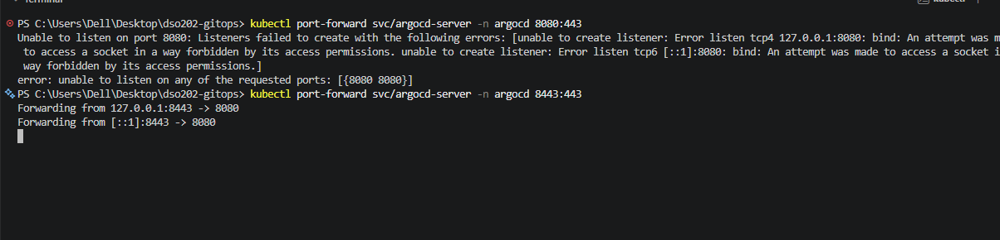

**Figure 14: Initial admin password read with kubectl (cluster since rebuilt; password no longer valid).** The initial admin password is read with kubectl and base64-decoded (that cluster was later deleted, so this password is no longer valid).

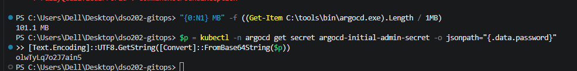

**Figure 15: Argo CD UI, empty Applications page.** The Argo CD UI is reachable and empty: nothing has been deployed from Git yet.

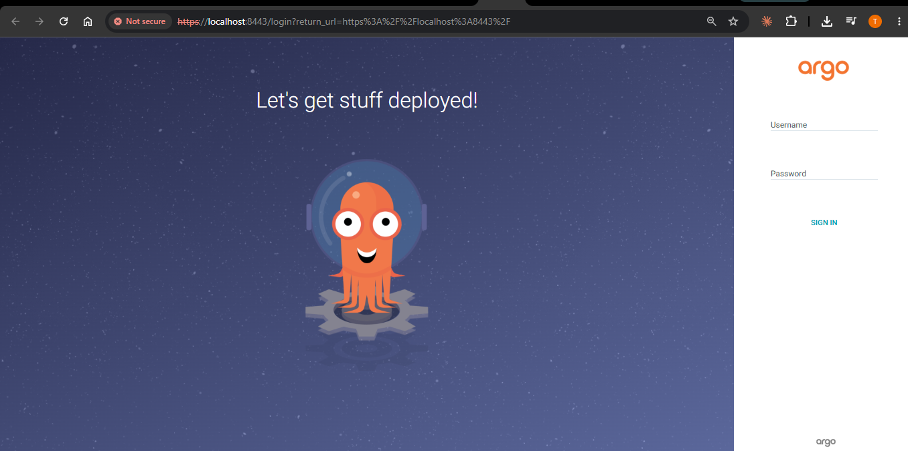

---

## Task 3: AppProjects and the root Application

**Figure 16: Applications page before the root Application.** Before the root Application exists there are no Applications; only bootstrap objects are in the cluster.

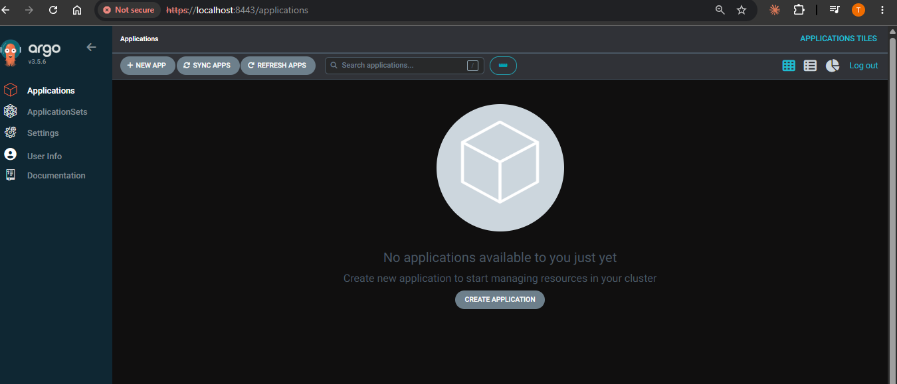

**Figure 17: Commit and kubectl apply -f bootstrap/root/.** bootstrap/root and argocd/projects are committed, then only platform-project.yaml and root-app.yaml are applied by hand.

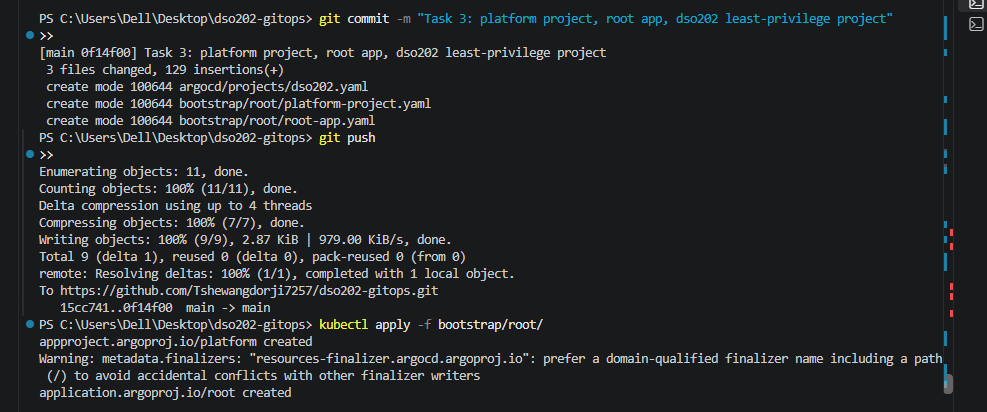

Only `platform` and `root` were applied by hand. The `dso202` project was created **by the root Application** from `argocd/projects/`, as its tracking-id shows:

```text
$ kubectl get appproject dso202 -n argocd -o jsonpath="{.metadata.annotations.argocd\.argoproj\.io/tracking-id}"
root:argoproj.io/AppProject:argocd/dso202
```

**Figure 18: root Synced/Healthy; projects default, dso202, platform.** root is Synced and Healthy, and dso202 appears seconds after platform, created from Git.

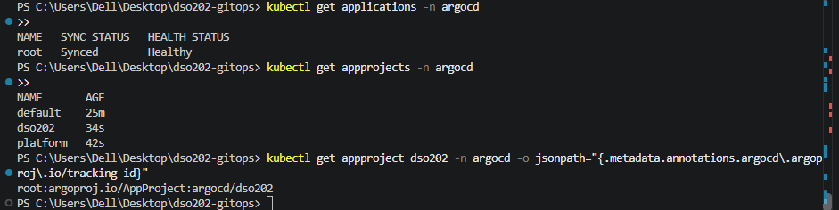

**Figure 19: tracking-id of dso202.** The tracking-id root:argoproj.io/AppProject:argocd/dso202 proves the root Application created the dso202 project, not a person.

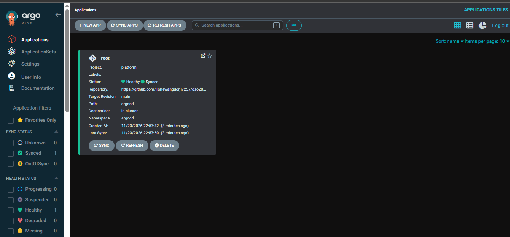

CLI view of the project and the root Application:

**Figure 20: argocd proj get dso202.** The dso202 project may read only this repository and deploy only to dso202-dev and dso202-staging, with no cluster-scoped kinds.

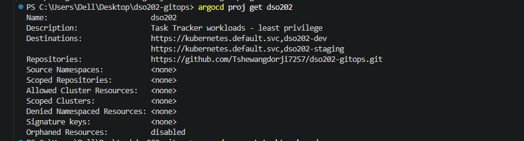

**Figure 21: argocd app get root.** root watches argocd/ on main with automated sync and prune, and manages the project and all child Applications.

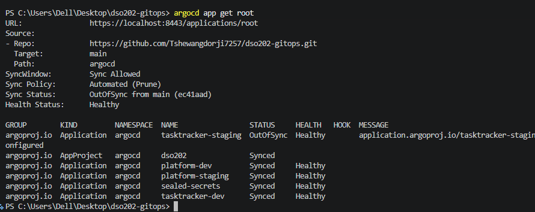

---

## Task 4: Sealed Secrets and the platform layer

### 4.1 Controller installed from Git (wave -2), through PR #1

**Figure 22: Branch, commit and push.** From Task 4 every change goes through a branch: the Sealed Secrets Application is committed on task4-sealed-secrets.

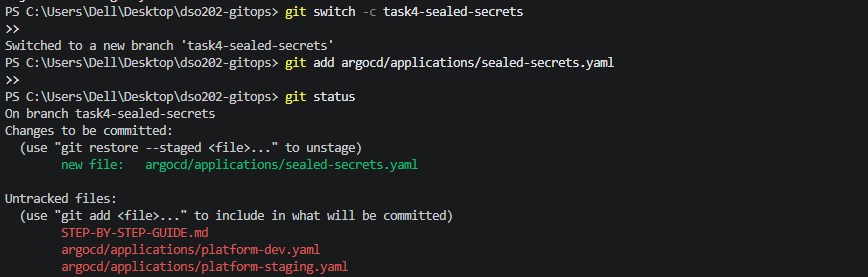

**Figure 23: git status: only sealed-secrets.yaml staged.** git status confirms that only sealed-secrets.yaml is staged; later files stay out of the commit.

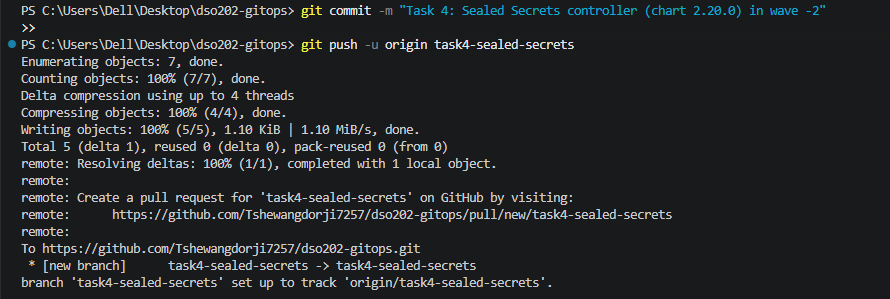

**Figure 24: PR merged.** PR #1 is merged into main; only after this can Argo CD see the change.

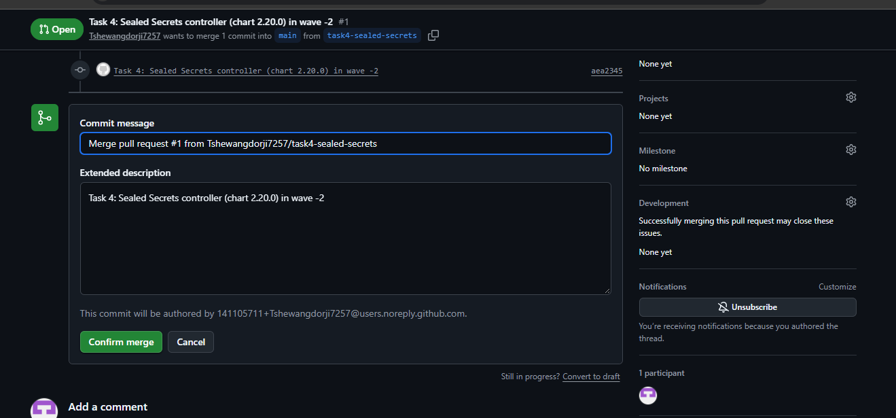

**Figure 25: git pull, merge commit on main.** git pull brings the merge commit to the local main branch.

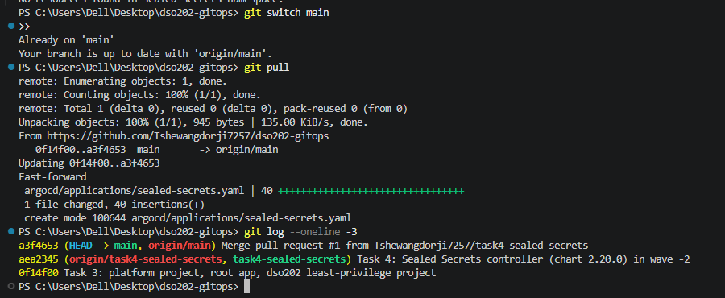

**Figure 26: sealed-secrets Synced/Healthy, controller Pod Running.** The root Application created sealed-secrets (wave -2), and the controller Pod is Running in its own namespace.

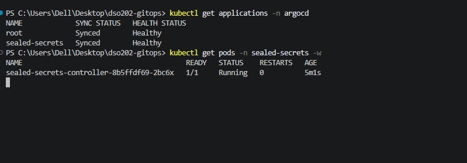

**Figure 27: UI: root and sealed-secrets.** The UI shows root and sealed-secrets, both Synced and Healthy.

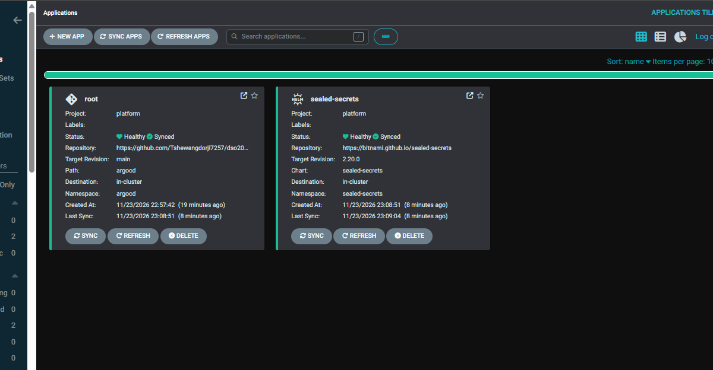

**Figure 28: UI: sealed-secrets tree (Deployment, ReplicaSet, Pod, Service, CRD).** The sealed-secrets tree shows what the Helm chart installed: controller Deployment, ReplicaSet, Pod, Service and the SealedSecret CRD.

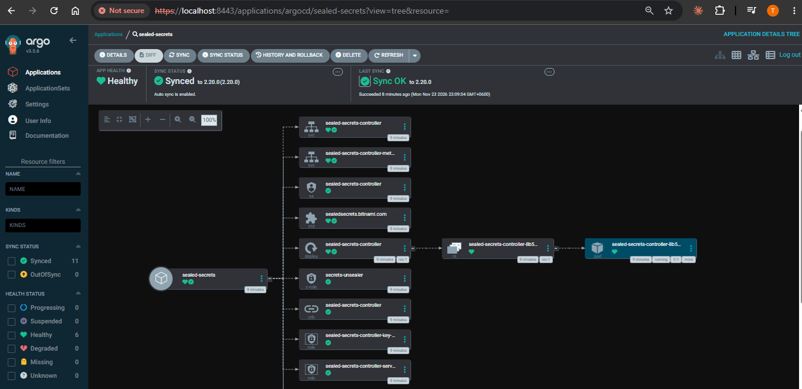

**Figure 29: UI: root tree with dso202 and sealed-secrets.** root now manages two children: the dso202 AppProject and the sealed-secrets Application.

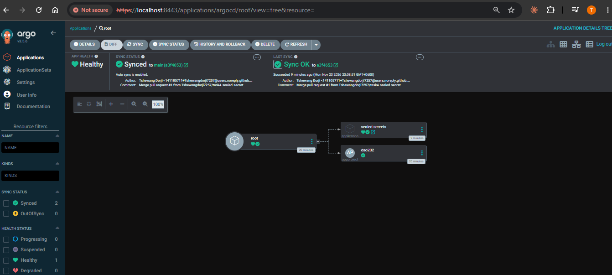

### 4.2 Sealing key backed up outside the repository
The backup is in `C:\Users\Dell\dso202-keys\`, outside the repository and matched by `.gitignore`. Its contents are not shown.

**Figure 30: Key backup file and key Secret.** The sealing key is backed up to C:\Users\Dell\dso202-keys, outside the repository; the key Secret exists in the cluster.

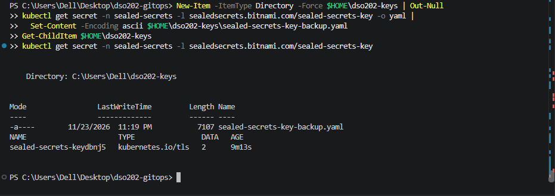

### 4.3 Credentials sealed with kubeseal
The plaintext Secret was piped from `kubectl create secret --dry-run=client` straight into `kubeseal`, so it was never written to disk. Dev and staging have separate passwords and separate SealedSecrets.

**Figure 31: kubeseal 0.40.0 available.** kubeseal 0.40.0 is installed, matching the controller version.

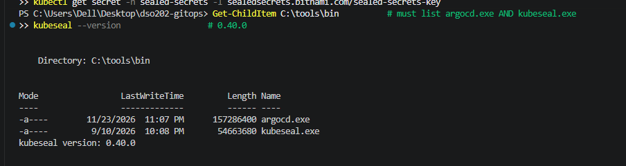

**Figure 32: Sealing both environments.** Each environment's credentials are sealed separately; the plaintext Secret is piped into kubeseal and never written to disk.

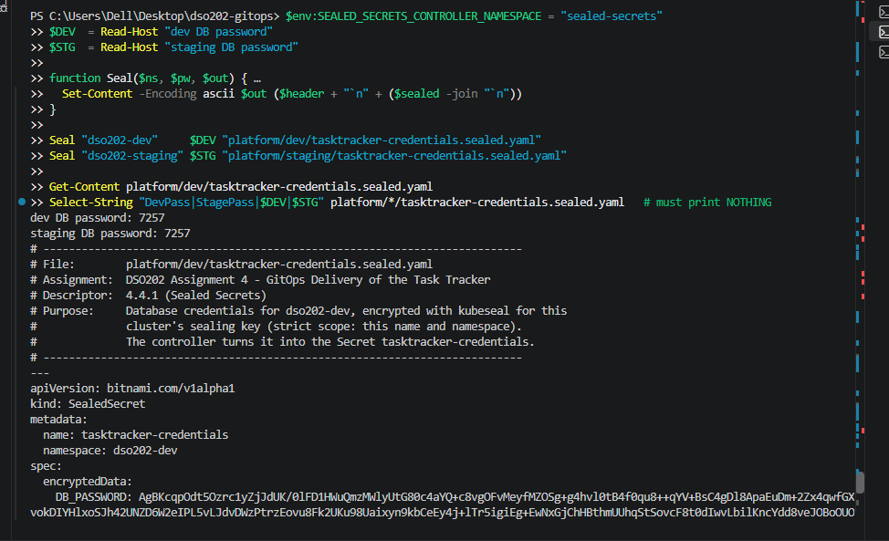

**Figure 33: SealedSecret: only encryptedData.** The resulting SealedSecret contains only encryptedData ciphertext, which is safe to commit.

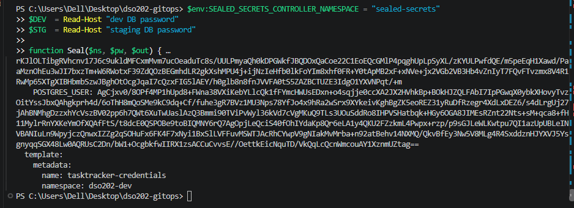

### 4.4 Platform layer delivered by platform-dev and platform-staging (wave -1)

**Figure 34: git status: platform files and two Applications staged.** git status shows exactly the eight platform files and the two platform Applications staged.

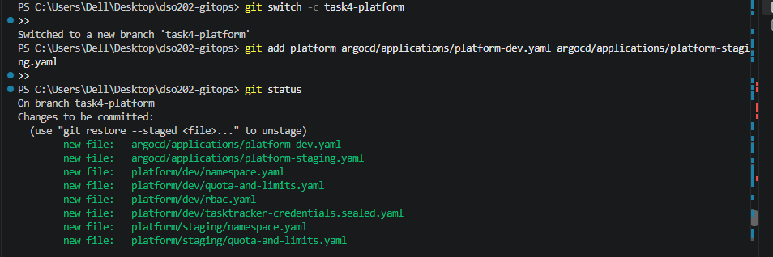

**Figure 35: Commit and push.** The platform layer is committed on its own branch and pushed.

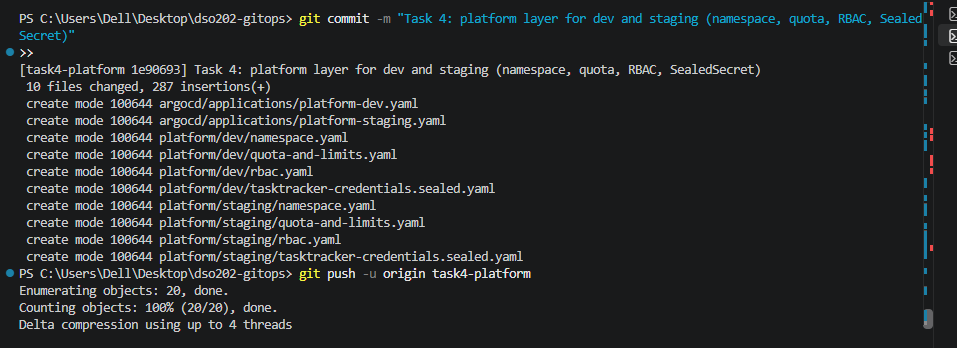

**Figure 36: PR created.** The pull request for the platform layer is opened on GitHub.

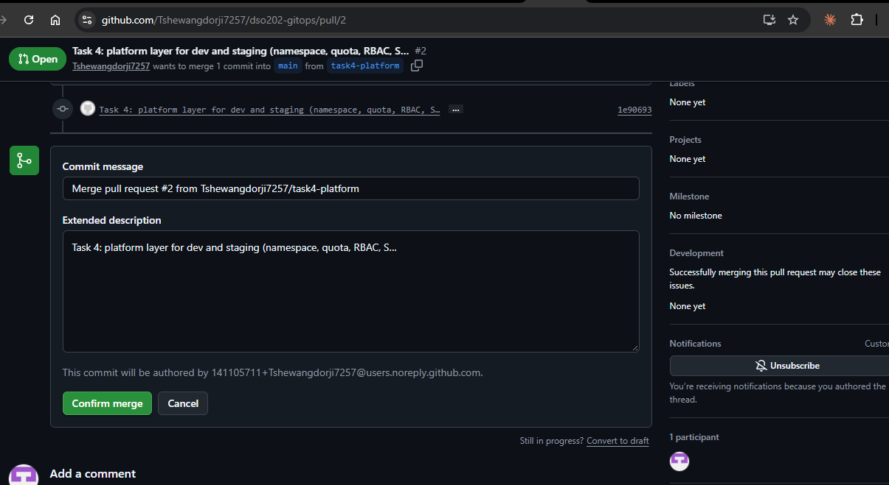

**Figure 37: PR merged.** The platform PR is merged; the change now exists in Git and nowhere else yet.

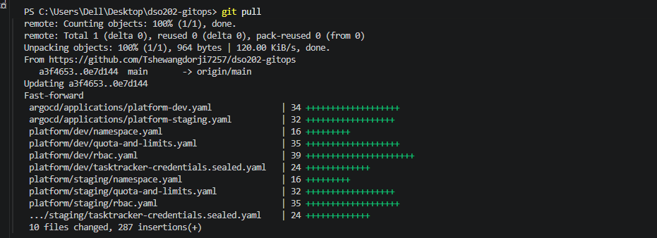

**Figure 38: Four Applications Synced/Healthy.** platform-dev and platform-staging (wave -1) are Synced and Healthy alongside root and sealed-secrets.

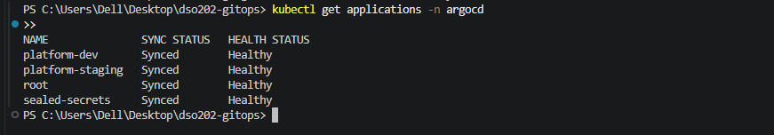

**Figure 39: SealedSecret and decrypted Secret in both namespaces.** In both namespaces the controller decrypted the SealedSecret into the Secret tasktracker-credentials (Opaque, 4 keys).

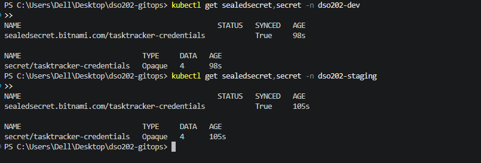

**Figure 40: Quota, LimitRange, Role, RoleBinding in dso202-dev.** The ResourceQuota, LimitRange, Role and RoleBinding from Assignment 2 now come from Git.

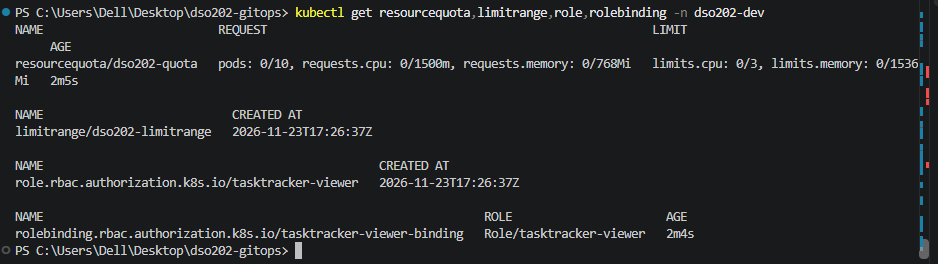

**Figure 41: UI: four green tiles.** The UI shows four green Applications.

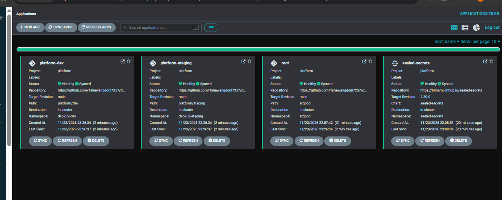

**Figure 42: UI: platform-dev tree, SealedSecret then Secret.** The platform-dev tree: Namespace, quota, limits, RBAC, and the SealedSecret owning the decrypted Secret.

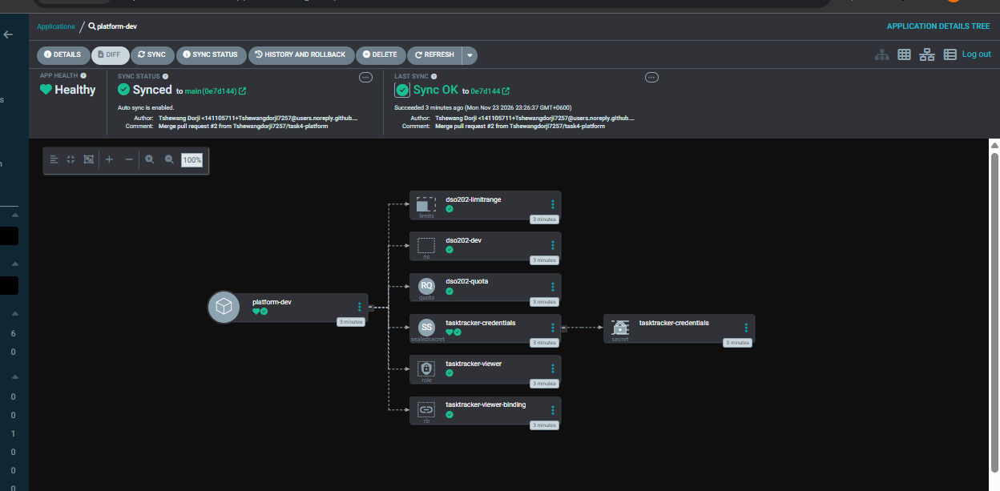

**Figure 43: UI: root tree with the platform Applications.** root manages the platform Applications in wave -1, after sealed-secrets in wave -2.

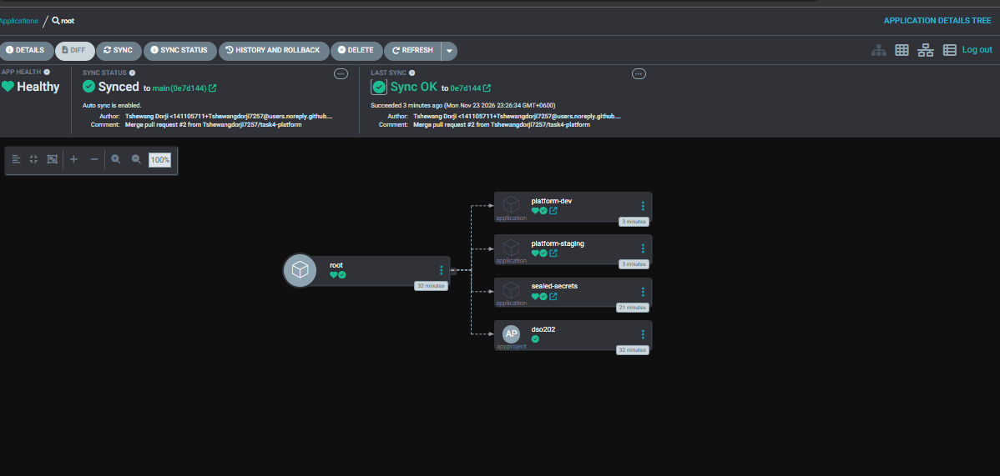

### 4.5 No plaintext in the Git history
The searches for both passwords return `0`. The only `kind: Secret` in the history is the Assignment 3 Helm **template** (commit `bbbf08d`). It contains template placeholders, not a value, and was removed in `160be5e`. No key file is tracked.

**Figure 44: History search for both passwords: 0 and 0.** Searching the full Git history for both database passwords returns 0 and 0: no credential value was ever committed.

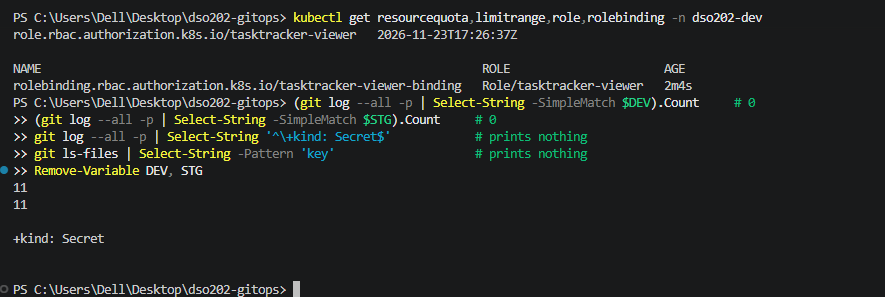

---

## Task 5: Workloads, sync waves and smoke test

### 5.1 Tag v1.0.0 and the two workload Applications (PR)

**Figure 45: Tag v1.0.0 pushed.** Tag v1.0.0 is pushed before the staging Application is committed, because staging must point at an existing tag.

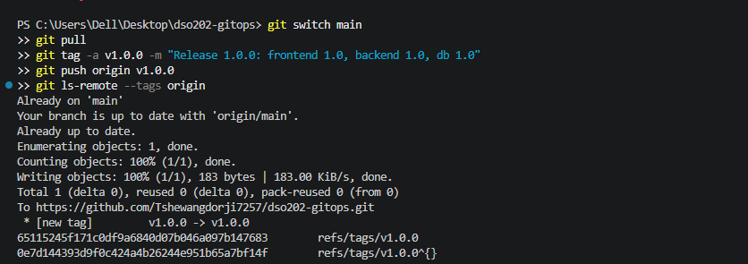

**Figure 46: Only the two tasktracker Applications staged.** Only tasktracker-dev.yaml and tasktracker-staging.yaml are staged for this PR.

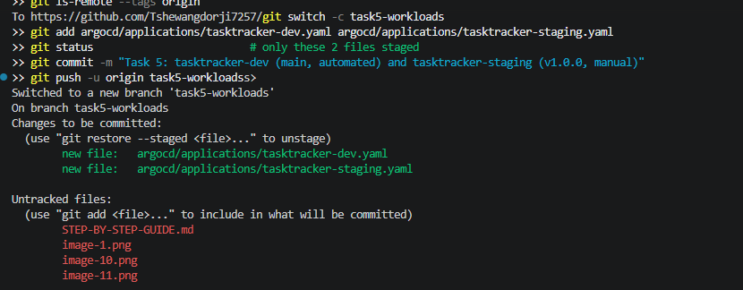

**Figure 47: Commit and push.** The workload Applications are committed and pushed on task5-workloads.

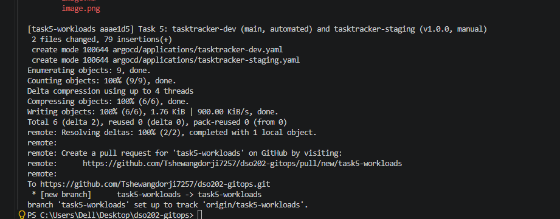

**Figure 48: PR created.** The pull request for the workloads is opened.

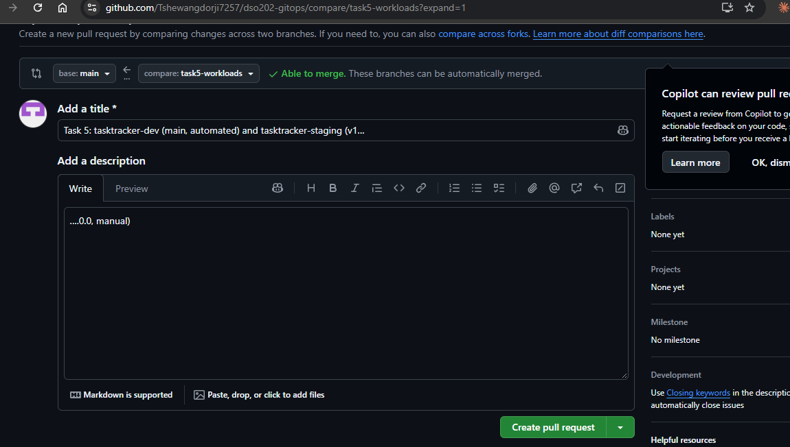

**Figure 49: PR merged.** The workload PR is merged into main.

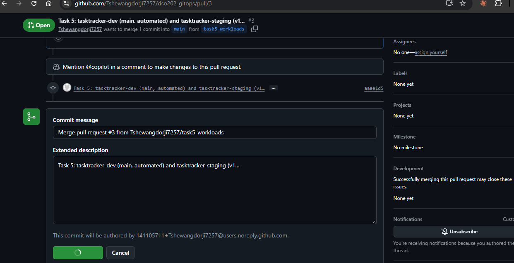

**Figure 50: git pull.** git pull updates main locally; Argo CD picks the change up on its next poll.

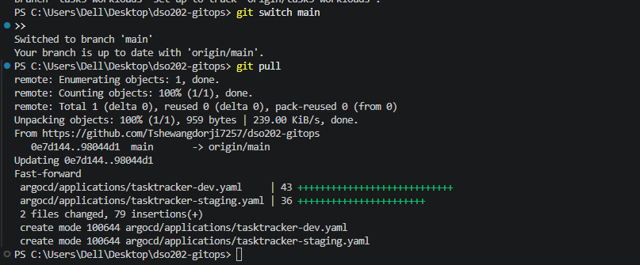

### 5.2 Sync waves apply in order: database, then backend, then frontend, then the smoke test
`db-0` became Ready first. Only then was the backend created (wave 2), then the frontend (wave 3), and finally the PostSync smoke-test Job, which reached `Completed`.

**Figure 51: kubectl get pods -w: db-0, then backend, then frontend, then smoke test.** Sync waves in action: db-0 becomes Ready first, then the backend is created, then the frontend, and last the PostSync smoke test completes.


**Figure 52: UI: tasktracker-dev while syncing.** The UI while tasktracker-dev is syncing: later waves have not been created yet.


**Figure 53: UI: tasktracker-dev sync progressing.** The tree fills in wave by wave as each earlier wave becomes Healthy.


### 5.3 Dev: automated, Synced/Healthy, smoke test passed

**Figure 54: tasktracker-dev Synced/Healthy; staging OutOfSync.** Dev is Synced and Healthy on its own (automated); staging is OutOfSync because it waits for a manual sync.


**Figure 55: Smoke test log: SMOKE TEST PASSED.** The smoke test reached /api/status and found "db":"connected", so the release works end to end.


**Figure 56: Pods, NodePort 30080 Service, Bound PVC.** Dev runs db-0, backend and frontend; the frontend Service is NodePort 30080 and the database PVC is Bound.


**Figure 57: UI: tasktracker-dev tree.** The tasktracker-dev tree is fully green, including the PostSync smoke-test Job.


**Figure 58: UI: dev details, target main, automated with prune and self-heal.** Dev follows branch main with automated sync, prune and self-heal.


**Figure 59: argocd app get tasktracker-dev.** CLI confirmation: tasktracker-dev targets main, sync policy Automated (Prune), Synced and Healthy.


### 5.4 Staging: the manual gate
Before the first sync, staging was **OutOfSync/Missing** and root was **Progressing**, because the restored Application health check makes root wait for every child. Staging only deployed when a person synced it.

**Figure 60: UI: staging OutOfSync, root Progressing.** Staging is OutOfSync/Missing and root is Progressing: nothing reaches staging until a person acts.


**Figure 61: UI: staging details, target v1.0.0, no automated sync.** Staging targets tag v1.0.0 with no automated sync policy.


**Figure 62: UI: sync dialog.** The manual SYNC dialog: this click is the promotion gate.


**Figure 63: UI: staging tree after sync (2 backend, 2 frontend, smoke Job).** After the manual sync, staging runs 2 backend and 2 frontend replicas, the database and a passed smoke test.


**Figure 64: All six Applications Synced/Healthy; staging smoke test passed.** All six Applications are Synced and Healthy, and root turns Healthy once staging is.


**Figure 65: argocd app get tasktracker-staging (Manual, v1.0.0).** CLI confirmation: tasktracker-staging targets v1.0.0 with a Manual sync policy.


### 5.5 Both environments serve the application (CRUD in dev)
The frontend calls the backend from the browser, so `BACKEND_URL` must be an address the browser can reach (see Problems, item 5). After the fix PR, dev connected through `localhost:8090`.

**Figure 66: Port-forward to the dev backend.** A port-forward exposes the dev backend on localhost:8090, the address now set as BACKEND_URL.


**Figure 67: Dev page: BACKEND + DB ONLINE.** The dev page shows BACKEND + DB ONLINE after the BACKEND_URL fix was merged and Argo CD rolled the Pods.


**Figure 68: Create: task #4 filed.** Create: a new task is filed through the UI and appears in the list.


**Figure 69: Read / update / delete through the API.** Read, update and delete through the API confirm the full CRUD cycle against the database.


### 5.6 CLI overview

**Figure 70: argocd login.** The argocd CLI logs in to the API server through the port-forward.


**Figure 71: argocd app list: six Applications.** argocd app list shows all six Applications with their projects, sync policies and target revisions.


---

## Task 6: reviewer account and RBAC

### 6.1 Password for the local account `reviewer`
The first attempt was rejected: Argo CD requires 8 to 32 characters. (The admin password shown belonged to the cluster that was later deleted in Task 9.)

**Figure 72: argocd account list / update-password.** The reviewer password is set by admin; the first try was rejected because Argo CD requires 8 to 32 characters.


### 6.2 Three permission states before the logs rule
```text
$ argocd account can-i get applications "dso202/*"   -> yes
$ argocd account can-i sync applications "dso202/*"  -> no
$ argocd account can-i get logs "dso202/*"           -> no
```
reviewer sees only the two dso202 Applications. The platform Applications are hidden.

**Figure 73: can-i yes/no/no and app list as reviewer.** As reviewer: get = yes, sync = no, logs = no, and only the two dso202 Applications are visible.


**Figure 74: UI as reviewer: only the two tasktracker tiles.** In the UI, reviewer sees only tasktracker-dev and tasktracker-staging; the platform Applications are hidden.


**Figure 75: UI as reviewer: sync denied.** reviewer clicks SYNC and is denied: read-only access works.


**Figure 76: UI as reviewer: no LOGS tab.** Before the logs rule, the resource panel shows no LOGS tab for reviewer.


### 6.3 Logs rule added through a commit (PR #5), then the bootstrap re-applied from Git

**Figure 77: Diff: logs rule uncommented.** The only change is uncommenting the logs rule in argocd-rbac-cm-patch.yaml.


**Figure 78: Commit and push.** The RBAC change is committed and pushed on task6-reviewer-logs.


**Figure 79: PR merged.** PR #5 with the logs rule is merged.


**Figure 80: Bootstrap re-applied; policy.csv now contains the logs rule.** bootstrap/argocd is re-applied from the merged Git version; the live policy.csv now contains the logs rule.


**Figure 81: can-i get logs: yes; sync: still no.** reviewer: logs = yes now, while sync is still no; the permission changed only through a commit.


**Figure 82: UI as reviewer: LOGS tab available.** After the commit, reviewer can open the logs view.


**Figure 83: UI as reviewer: backend log lines.** The backend log lines are visible to reviewer.


---

## Task 7: Release, failure and recovery

### 7.0 root cleaned before the release
root stayed OutOfSync because of an empty `syncPolicy: {}` (see Problems, item 6). It was fixed by a PR.

**Figure 84: argocd app diff root / fix.** root showed OutOfSync with an empty diff, caused by the empty syncPolicy; fixed by a PR before the release work.


### 7.1 Frontend 1.1 promoted through the gate (tag v1.1.0)
**Staging BACKEND_URL fix (merged to main, but it reached staging only with v1.1.0):**

**Figure 85: Diff: staging BACKEND_URL.** Staging gets a browser-reachable BACKEND_URL (localhost:8091); this is merged to main but cannot reach staging before the next tag.


**Figure 86: PR created.** The staging BACKEND_URL pull request is opened.


**Figure 87: PR merged.** The staging BACKEND_URL PR is merged; staging is still on v1.0.0.


**Frontend 1.1 merged to main. Dev updated by itself; staging stayed on v1.0.0:**

**Figure 88: Diff: frontend tag 1.0 to 1.1.** The release is one line: the frontend image tag changes from 1.0 to 1.1.


**Figure 89: PR created.** The frontend 1.1 pull request is opened.


**Figure 90: PR merged.** The frontend 1.1 PR is merged into main.


**Figure 91: Dev frontend image is :1.1.** Dev now runs rynorbu11/dso202-frontend:1.1, deployed automatically after the merge.


**Figure 92: Dev Synced/Healthy, smoke test succeeded.** Dev is Synced and Healthy, and the smoke test succeeded on the new release.


**Figure 93: Staging still Synced to v1.0.0: the gate holds.** Staging is still Synced to v1.0.0: a merge to main does not reach staging.


**Figure 94: Dev page shows RELEASE 1.1.** The dev page shows RELEASE 1.1, the change described in the release note.


**Figure 95: UI: dev history with the new revision.** Dev history shows a new revision for the frontend release.


**Tag v1.1.0 and promotion PR. Staging waited for a person:**

**Figure 96: Tag v1.1.0 pushed.** Tag v1.1.0 marks the commit that contains frontend 1.1 and the staging BACKEND_URL fix.


**Figure 97: Promotion branch.** A promotion branch is created; promotion is a reviewed change in Git, not a click in the UI.


**Figure 98: Diff: targetRevision v1.0.0 to v1.1.0.** The promotion is one line: targetRevision v1.0.0 to v1.1.0.


**Figure 99: Promotion PR merged.** The promotion PR is merged.


**Figure 100: Staging: target v1.1.0, OutOfSync.** Staging now targets v1.1.0 but is OutOfSync: it knows the release but has not applied it.


**Figure 101: UI: staging tile OutOfSync.** The staging tile is yellow (OutOfSync) while it waits for a person.


**Figure 102: UI: staging diff before sync (frontend image, BACKEND_URL, config checksum).** The diff before syncing shows exactly what will change: frontend image, BACKEND_URL and the config checksum.


**Figure 103: Staging Synced to v1.1.0, Healthy.** After the manual sync, staging is Synced to v1.1.0 and Healthy.


**Figure 104: Staging history: v1.0.0, then v1.1.0.** Staging history: v1.0.0, then v1.1.0.


**Figure 105: Staging smoke test passed.** The smoke test passed in staging on v1.1.0.


**Figure 106: Staging page: BACKEND + DB ONLINE, RELEASE 1.1.** The staging page shows BACKEND + DB ONLINE and RELEASE 1.1; the BACKEND_URL fix arrived with the promotion.


### 7.2 Backend 1.1 fails in dev (staging untouched)

**Figure 107: Diff: backend tag 1.0 to 1.1.** The faulty release is also one line: the backend tag changes from 1.0 to 1.1; no tag is created.


**Figure 108: PR created.** The backend 1.1 pull request is opened.


**Figure 109: PR merged.** The backend 1.1 PR is merged, so only dev receives it.


**Figure 110: New backend Pod CrashLoopBackOff; old 1.0 Pod still Running.** The new backend Pod crashes (Error, CrashLoopBackOff) while the old 1.0 Pod keeps serving: the rolling update protects dev.


**Figure 111: describe: image :1.1, exit code 1.** describe shows image dso202-backend:1.1 exiting with code 1 on every start.


**Figure 112: tasktracker-dev Degraded.** After progressDeadlineSeconds (120 s) the Deployment fails and Argo CD reports tasktracker-dev as Degraded.


**Figure 113: UI: backend-deployment Degraded.** The UI marks backend-deployment as Degraded.


**Diagnosis from the logs.** The release note said *"Internal refactoring of configuration loading. The API is unchanged."* The container log shows that the new image needs a new setting at start-up:

```text
FATAL: required setting TASK_PAGE_SIZE is missing or invalid (backend 1.1). Set TASK_PAGE_SIZE to a positive integer, e.g. TASK_PAGE_SIZE=50
```
(The Pod restarted too quickly for `kubectl logs --previous`. The line was read from a one-off diagnostic Pod of the same image in the unmanaged `default` namespace, which was deleted straight after.)

### 7.3 `argocd app rollback` is refused
The last good revision was ID 2 (frontend 1.1). The rollback was refused because automated sync is enabled: a rollback in the cluster would be overwritten by the next sync, so Git is the only way back.

```text
ID  DATE                           REVISION
0   2026-11-23 23:41:53 +0600 +06  main (98044d1)
1   2026-11-24 00:15:18 +0600 +06  main (ec41aad)
2   2026-11-24 15:27:22 +0600 +06  main (824c589)
```

**Figure 114: argocd app rollback refused.** argocd app rollback is refused because automated sync is enabled; under GitOps the way back is through Git.


### 7.4 Recovery by `git revert` (PR #11)

**Figure 115: Revert PR created with GitHub's Revert button and merged.** GitHub's Revert button creates PR #11, which undoes the backend release in a new commit.


**Figure 116: git log: Revert "Task 7: release backend 1.1".** git log shows the revert commit on top while the faulty commit stays in the history.


**Figure 117: Dev Synced/Healthy again.** After the revert, tasktracker-dev is Synced and Healthy again.


**Figure 118: Only the 1.0 backend Pod remains.** Only the healthy 1.0 backend Pod remains; the crashing Pod is gone.


**Figure 119: Backend image back to :1.0.** The backend image is back to rynorbu11/dso202-backend:1.0.


**Figure 120: /api/status: ok, db connected.** The API answers ok with the database connected.


**Figure 121: UI: dev green again.** The dev tile is green again.


**Staging never ran the faulty release:**
```text
$ argocd app history tasktracker-staging
ID  DATE                           REVISION
0   2026-11-23 23:58:29 +0600 +06  v1.0.0 (0e7d144)
1   2026-11-24 15:42:33 +0600 +06  v1.1.0 (824c589)
$ kubectl get deploy backend-deployment -n dso202-staging -o jsonpath="{...image}"
rynorbu11/dso202-backend:1.0
```

**Figure 122: Staging still v1.1.0.** Staging is still on v1.1.0 and Healthy: it never received backend 1.1.


**Figure 123: Staging history.** Staging history contains only v1.0.0 and v1.1.0.


**Figure 124: Staging backend still :1.0.** The staging backend image is still :1.0.


### 7.5 Fix-forward (PR #12, tagged v1.2.0) and promotion (PR #13)
`TASK_PAGE_SIZE` is not secret, and both environments need it, so it was added to the chart defaults (ConfigMap) together with backend 1.1.

**Figure 125: Diff and helm lint: TASK_PAGE_SIZE "50" + backend 1.1.** The fix-forward adds TASK_PAGE_SIZE: "50" to the chart defaults and sets backend 1.1; helm lint still passes.


**Figure 126: PR merged.** The fix-forward PR #12 is merged.


**Figure 127: Dev backend :1.1, 1/1 Running.** Backend 1.1 now starts and is 1/1 Running.


**Figure 128: ConfigMap TASK_PAGE_SIZE = 50.** The ConfigMap contains TASK_PAGE_SIZE = 50.


**Figure 129: Dev Synced/Healthy.** Dev is Synced and Healthy on backend 1.1.


**Figure 130: Dev smoke test passed.** The smoke test passed on the fixed release.


**Figure 131: Dev page working on backend 1.1.** The dev page works on backend 1.1.


**Figure 132: Tag v1.2.0.** Tag v1.2.0 marks the fixed release.


**Figure 133: Promotion to v1.2.0.** Staging is promoted by changing targetRevision to v1.2.0.


**Figure 134: Promotion PR merged.** The promotion PR #13 is merged.


**Figure 135: UI: staging diff before sync (backend image, TASK_PAGE_SIZE).** The diff before syncing staging: the backend image and TASK_PAGE_SIZE.


**Figure 136: Staging Synced to v1.2.0.** Staging is Synced to v1.2.0.


**Figure 137: Staging history: v1.0.0, v1.1.0, v1.2.0.** Staging history is v1.0.0, then v1.1.0, then v1.2.0: it never ran the faulty release.


**Figure 138: Staging smoke test passed.** The smoke test passed in staging on v1.2.0.


**Figure 139: Staging page on the final release.** The staging page works on the final release.


### 7.6 The whole story in Git
```text
*   ffbc042 Merge pull request #13 ... promote-staging-v1.2.0
| * d524dc5 Task 7: promote staging to v1.2.0
*   3e12109 (tag: v1.2.0) Merge pull request #12 ... fix-backend-1.1
| * c0aef31 Task 7: backend 1.1 with required TASK_PAGE_SIZE (fix-forward)
*   b4fe2ce Merge pull request #11 ... revert-10-release-backend-1.1
| * e9e6b3a Revert "Task 7: release backend 1.1"
*   3fbba8f Merge pull request #10 ... release-backend-1.1
| * a154dc5 Task 7: release backend 1.1
*   85bb0ab Merge pull request #9 ... promote-staging-v1.1.0
| * 2dc4bb2 Task 7: promote staging to v1.1.0
```
Pull request list: GitHub, *Pull requests → Closed* (add a screenshot here if your report needs one).

---

## Task 8: Drills

| Drill | Action | Prediction (before running) | Observation | Explanation |
|---|---|---|---|---|
| 1 Self-heal (dev) | `kubectl scale deployment frontend-deployment -n dso202-dev --replicas=3` | Argo CD will put it back to 1 replica within seconds | Replicas went 1 → 3 → 1; events show the scale-up and the scale-down | `selfHeal: true`: live state differed from Git, so Argo CD re-applied Git |
| 2 Drift (staging) | `kubectl scale ... -n dso202-staging --replicas=4` | Argo CD will report OutOfSync but leave 4 replicas | Still 4/4 after 70 s; staging OutOfSync; diff shows 2 (Git) vs 4 (live). A manual `argocd app sync` restored 2/2 | Staging has no automated sync: drift is detected and reported, but only a person restores it |
| 3 Prune | Add `platform/dev/prune-drill.yaml` (PR), then `git rm` it (PR) | The ConfigMap will be created, then deleted when the file is removed | `prune-drill` appeared in dso202-dev, then returned NotFound | `prune: true` deletes live objects whose file was removed from Git |
| 4 Project boundary | Add `charts/tasktracker/templates/drill-quota.yaml` (PR), then revert (PR) | Argo CD will refuse the ResourceQuota | `SyncFailed: resource :ResourceQuota is not permitted in project dso202`; no drill-quota exists; staging unaffected | The dso202 whitelist has no ResourceQuota: a chart commit cannot widen its own limits (least privilege) |

### Drill 1: self-heal in dev

**Figure 140: Scale to 3, back to 1, events.** Dev was scaled to 3 by hand and returned to 1 within seconds; the events show the scale-up and the scale-down.


### Drill 2: drift in staging

**Figure 141: Still 4/4 after 70 s.** Staging stayed at 4 replicas after 70 seconds: the manual change was not reverted.


**Figure 142: Staging OutOfSync.** Argo CD reports staging as OutOfSync: the drift is detected.


**Figure 143: UI diff: replicas 2 (Git) vs 4 (live).** The UI diff shows 2 replicas in Git and 4 live.


**Figure 144: Restored by a manual sync: 2/2, Synced.** A manual sync restored 2/2 replicas and Synced status.


### Drill 3: prune

**Figure 145: Add prune-drill.yaml.** prune-drill.yaml is added under platform/dev through a branch and a PR.


**Figure 146: PR merged.** The PR adding the drill ConfigMap is merged.


**Figure 147: ConfigMap exists.** The prune-drill ConfigMap exists in dso202-dev, created from Git.


**Figure 148: UI: platform-dev with prune-drill.** The platform-dev tree shows prune-drill.


**Figure 149: After removal: NotFound.** After the file was removed by a PR, the ConfigMap returns NotFound: it was pruned.


**Figure 150: UI: platform-dev without prune-drill.** The platform-dev tree no longer contains prune-drill.


### Drill 4: project boundary
```text
GROUP  KIND           NAMESPACE   NAME          STATUS  HEALTH      MESSAGE
       ResourceQuota  dso202-dev  drill-quota           SyncFailed  resource :ResourceQuota is not permitted in project dso202
```

**Figure 151: drill-quota.yaml added.** A chart template that tries to create a ResourceQuota is committed.


**Figure 152: SyncFailed: not permitted in project dso202.** Argo CD refuses it: SyncFailed, ResourceQuota is not permitted in project dso202.


**Figure 153: Only dso202-quota exists.** Only the platform quota dso202-quota exists; drill-quota was never created.


**Figure 154: Staging unaffected (v1.2.0).** Staging is unaffected because it is pinned to v1.2.0.


**Figure 155: UI: sync error on tasktracker-dev.** The UI shows the sync error on tasktracker-dev.


**Figure 156: Revert PR.** The drill commit is reverted through a PR.


**Figure 157: Dev Synced/Healthy after the revert.** After the revert, dev is Synced and Healthy again.


---

## Task 9: Rebuild from the repository and the key

### 9.1 Safety checks (clean tree, key backup present)

**Figure 158: Safety checks.** Safety checks before deleting: nothing uncommitted, GitHub up to date, key backup present.


### 9.2 Start time; cluster deleted

**Figure 159: Start and delete.** The clock starts and the cluster is deleted, removing every object and the sealing key from the cluster.


### 9.3 New cluster; Argo CD from `bootstrap/argocd`

**Figure 160: kind create.** A new cluster is created from the same kind configuration in Git.


**Figure 161: Argo CD apply.** Argo CD is installed again from bootstrap/argocd.


**Figure 162: Seven Pods.** The seven Argo CD Pods are Running on the new cluster.


### 9.4 Old sealing key restored before the controller started

**Figure 163: Key restored.** The old sealing key is restored before the controller starts, so the SealedSecrets in Git can be decrypted.


### 9.5 `bootstrap/root` applied; Git takes over

**Figure 164: Root applied.** bootstrap/root is applied; from here Git rebuilds everything wave by wave.


### 9.6 Login, staging synced, reviewer reset

**Figure 165: Login.** Login on the new cluster with its new admin password.


**Figure 166: Sync staging.** Staging is synced by hand, as required for the gate.


**Figure 167: Reviewer.** The reviewer password is set again, since local account passwords are not stored in Git.


### 9.7 All six Applications Synced/Healthy

**Figure 168: app list.** All six Applications are Synced and Healthy on the rebuilt cluster.


### 9.8 Old SealedSecrets decrypted by the restored key

**Figure 169: Secret dev.** The dev Secret was decrypted from the SealedSecret in Git with the restored key.


**Figure 170: Secret staging.** The staging Secret was decrypted with the same restored key.


### 9.9 Staging back on v1.2.0

**Figure 171: Staging v1.2.0.** Staging is back on v1.2.0, taken from Git.


### 9.10 Smoke tests passed in both environments

**Figure 172: Smoke dev.** The smoke test passed in dev on the rebuilt cluster.


**Figure 173: Smoke staging.** The smoke test passed in staging on the rebuilt cluster.


### 9.11 UI on the new cluster

**Figure 174: All six green.** The UI of the new cluster shows all six Applications green.


### 9.12 Application working

**Figure 175: Browser.** The application works again in the browser after the rebuild.


**Elapsed time:** `hh:mm:ss` (from `$start` to `$end`, including image downloads on a slow connection).

---

## Problems met and how they were solved

| # | Problem | Cause | Fix |
|---|---|---|---|
| 1 | First push was one large "first commit" | Repository initialised before following the commit plan | History rebuilt with `.gitignore` first and one commit per step, then force-pushed once (new repository, single user) |
| 2 | `argocd.exe`: "used by another process", then "not a valid application" | Download still running, then cut off at exactly 150 MB | Re-downloaded with the browser and verified with SHA-256 against `cli_checksums.txt` of v3.5.6 |
| 3 | `kubectl port-forward ... 8080:443` refused | Windows reserves port 8080 | Used port 8443 |
| 4 | History check found 11 matches for the password | Password `7257` is part of the repository URL (`Tshewangdorji7257`), and both environments used it | Re-sealed with separate, longer passwords through a PR; search then returned 0 and 0 |
| 5 | Frontend showed "BACKEND UNREACHABLE" | The browser calls `BACKEND_URL`; `backend-svc` exists only inside the cluster | Per-environment `BACKEND_URL` (`localhost:8090` dev, `localhost:8091` staging) plus port-forwards. Dev got it on merge; staging only with the v1.1.0 promotion, as the gate requires |
| 6 | root stayed OutOfSync with an empty diff | `syncPolicy: {}` is not kept by the API server, so Git and live never matched | Removed the empty `syncPolicy` (PR) |
| 7 | `argocd app diff` printed headers but no lines | The argocd CLI on Windows needs an external `diff` program | `KUBECTL_EXTERNAL_DIFF` pointed at Git's `diff.exe`; the UI DIFF view used for screenshots |
| 8 | No Pods and no LOGS tab in the UI for dso202 apps | Argo CD only shows kinds the project permits; Pod and ReplicaSet are not in the dso202 whitelist | Kept least privilege (whitelist = `helm template` kinds); Pod-level checks done with `kubectl` |
| 9 | `kubectl logs --previous` returned nothing for the crashing backend | The container restarted faster than its log could be read | Read the start-up error from a one-off Pod of the same image in the unmanaged `default` namespace |
| 10 | Finalizer warning on `kubectl apply` of root | Kubernetes 1.36 warns about finalizer names without `/` | No action: `resources-finalizer.argocd.argoproj.io` is Argo CD's official finalizer |